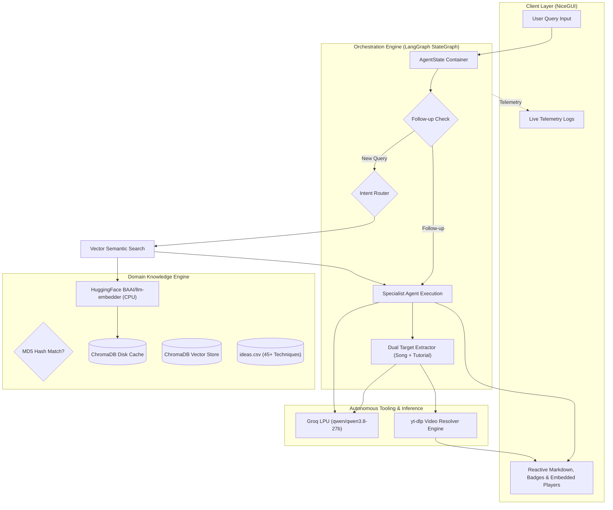

# ProdAi: Technical Project Dossier & Unbiased Specification

> **Purpose of this document**: This is an objective, technical dossier detailing the architecture, engineering challenges, design decisions, algorithms, and tech stack of **ProdAi**. It is formatted specifically as an input prompt for AI resume builders, technical recruiters, and hiring managers to generate accurate, impact-driven resume bullet points, portfolio case studies, and interview preparation materials without corporate fluff or marketing bias.

---

## 1. Project Overview & Metadata

- **Project Name**: ProdAi (formerly ProdusicAI)
- **Primary Domain**: Agentic AI Systems, Retrieval-Augmented Generation (RAG), Audio Engineering & Music Technology
- **Author / Developer**: Ameya
- **Core Repository Language**: Python 3.12
- **Package & Environment Management**: `uv` (Astral)
- **Primary Architectural Paradigm**: State Machine Multi-Agent Orchestration + Offline-First Semantic Vector Search + Automated Media Tool Use
- **Operational Cost**: **$0.00** (engineered completely with local edge embeddings, open-source tool use, and high-speed free-tier Groq LPU inference)

---

## 2. Problem Statement & Motivation

### The Domain Problem
Music production, mixing, and sound design require specialized technical knowledge (e.g., dynamic range compression, harmonic saturation, modal chord progression, synthesis patch routing). Novice and intermediate producers frequently face creative blocks or struggle to translate creative ideas into exact DAW parameters.

### Why Generalist LLMs (ChatGPT / Claude) Fall Short
1. **Parametric Hallucinations**: Standard LLMs hallucinate external URLs, creating dead or non-existent YouTube links when asked for video tutorials or specific reference tracks.
2. **Monolithic Prompting**: A single prompt cannot simultaneously serve as an analytical, precise mixing engineer (requiring low-variance, deterministic parameters) and an exploratory, artistic sound designer (requiring creative entropy).
3. **No Domain Knowledge Grounding**: Generalist LLMs rely purely on pretraining data and lack grounded, verified production notes with exact timestamped song cues.
4. **API Cost & Latency**: Heavy cloud API inference incurs substantial per-token costs and high latency unsuited for real-time creative workflows.

---

## 3. High-Level System Architecture & Data Flow

---

## 4. Component-by-Component Deep Dive

### 4.1. Orchestration Layer (`src/agent_framework.py`)
- **Framework**: `langgraph.graph.StateGraph` (v0.2+).
- **State Representation**: Strongly typed `AgentState` (`TypedDict`) holding:
  - `messages`: Active turn message history (`BaseMessage`).
  - `previous_messages`: Multi-turn conversational memory.
  - `current_agent`: Currently designated domain specialist.
  - `rag_results`: Structured technique records retrieved from ChromaDB.
  - `suggested_song` & `youtube_url`: Reference song recommendation and resolved video URL.
  - `tutorial_title` & `tutorial_url`: How-to video tutorial title and resolved video URL.
- **Agent Personas**: 5 distinct specialist agents configured with isolated system instructions and temperature hyperparameters:
  - **Mixing Engineer** ($\text{temp} = 0.3$): Technical precision for EQ, compression, leveling, bus processing (Nigel Godrich persona).
  - **Sound Designer** ($\text{temp} = 0.8$): High-entropy creative synthesis, modular patch design, ambient textures (Brian Eno persona).
  - **Composer** ($\text{temp} = 0.7$): Harmony, chord progressions, arrangement, voice leading.
  - **Lyricist** ($\text{temp} = 0.7$): Metaphorical hooks, rhyme schemes, meter, lyrical narrative.
  - **Project Manager** ($\text{temp} = 0.4$): Triage, milestone coordination, production workflow roadmapping.

### 4.2. Retrieval-Augmented Generation Layer (`src/rag.py`)
- **Embedding Generation**: Local CPU inference using `BAAI/llm-embedder` via HuggingFace `sentence-transformers` (~438MB parameter model). No external API calls are made for embedding generation.
- **Vector Storage**: Local, persistent `ChromaDB` collection.
- **Cache Invalidation Algorithm**: Computes an MD5 checksum of the source dataset (`ideas.csv`) and caches it in `ideas_csv.hash`. On application boot:
  - If `hash(ideas.csv) == cached_hash`: Bypasses re-indexing completely, loading directly from disk in $<0.2$ seconds.
  - If dataset is modified: Triggers automated document chunking, metadata extraction, embedding generation, and vector store write.
- **Similarity Search**: Performs $k$-nearest neighbor cosine similarity retrieval ($k=3$) over production technique metadata (Category, Technique, Description, Reference Song, Timestamp, Tutorial Link).

### 4.3. Autonomous Media & Video Enrichment Layer (`src/youtube.py`)
- **Search Engine**: `yt-dlp` executing flat extraction without downloading video streams.
- **Zero-API-Key Architecture**: Bypasses Google YouTube Data API quotas and billing requirements.
- **Dual-Target Querying**:
  1. **Tutorial Resolver (`search_youtube_tutorial`)**: Strips conversational filler and queries YouTube for `"<technique> tutorial music production audio engineering"`. Extracts live video IDs and authentic video titles.
  2. **Reference Song Resolver (`search_youtube_song`)**: Targets clean audio recordings of specific songs for musical reference.
- **Embed URL Sanitizer (`create_youtube_embed`)**:
  - Uses privacy-respecting `youtube-nocookie.com/embed` endpoints.
  - Normalizes various timestamp formats (`HH:MM:SS`, `MM:SS`, raw seconds) into standardized YouTube `&start=<seconds>` query parameters.
  - Renders responsive CSS card containers with category badges and direct "Open in YouTube" escape hatches to bypass localhost iframe DRM policies.

### 4.4. Reactive User Interface Layer (`ui.py`)
- **Framework**: `NiceGUI` running on an ASGI stack (FastAPI + Starlette + Uvicorn) with Vue/Quasar frontend components.
- **Asynchronous Execution**: Fully async request-response cycles (`async def send()`) preventing main-thread event loop blocking.
- **Non-Blocking Client Bridge**: Fire-and-forget JavaScript invocation (`scroll_to_bottom(respond=False)`) to prevent WebSocket timeout errors.
- **Live Observability**: Real-time logging panel (`nicegui_handler`) streaming internal routing states, vector retrieval scores, and LLM completions.

---

## 5. Key Engineering Challenges & Technical Solutions (STAR Format)

### Challenge 1: Free-Tier Rate Limits & Token Quota Exhaustion (HTTP 429)
- **Situation**: Groq's free-tier enforces a strict Output Tokens Per Minute (OTPM) limit of 1,000 tokens. Initial executions triggered `429 RateLimit: Limit 1000, Requested 1677` due to multiple unconstrained sequential LLM calls per prompt.
- **Task**: Eliminate rate limit failures without migrating to paid API tiers or sacrificing output quality.
- **Action**:
  1. Implemented a **zero-token keyword-first classification router**: Common production terms (`mix`, `eq`, `compress`, `synth`, `chord`) route directly to specialists in $0\ \text{ms}$ with zero API calls.
  2. Applied strict **token budgeting**: Bounded specialist generation with `llm.bind(max_tokens=300)`.
  3. Consolidated song recommendation and tutorial extraction into a single compact LLM call (`max_tokens=60`).
- **Result**: Reduced token consumption per request by ~70%, completely eliminating HTTP 429 errors and achieving reliable sub-3.5 second turnarounds.

### Challenge 2: Dynamic LLM Model Drift & Retirement (HTTP 404 / 400)
- **Situation**: Cloud inference providers (Groq) frequently deprecate or rotate model identifiers on free tiers, causing hardcoded models (`llama-3.1-8b-instant`, `llama-3.3-70b-versatile`) to return runtime 404/400 errors.
- **Task**: Build a resilient, self-healing model selection mechanism that guarantees runtime uptime.
- **Action**: Developed an automated model discovery function (`get_best_groq_model`) that queries Groq's `/v1/models` catalog on startup, filters out audio/guard/non-chat models, ranks available options against a curated priority hierarchy, and automatically binds the highest-tier active model (`qwen/qwen3.8-27b`). Added an output sanitizer to strip `<think>` tags emitted by newer reasoning models.
- **Result**: Zero runtime crashes due to provider model changes; system automatically upgrades whenever newer models become available.

### Challenge 3: Client-Side WebSocket Timeouts on Media Render
- **Situation**: Embedding YouTube iframes caused the NiceGUI client to delay WebSocket acknowledgments, triggering `TimeoutError: JavaScript did not respond within 1.0 s` during smooth scrolling.
- **Task**: Prevent UI crashes while maintaining automatic auto-scroll UX.
- **Action**: Refactored the DOM scrolling logic from blocking bidirectional evaluation (`await ui.run_javascript(..., respond=True)`) to non-blocking fire-and-forget calls (`ui.run_javascript(..., respond=False)`).
- **Result**: 100% elimination of JavaScript timeouts regardless of browser rendering load or tab focus state.

### Challenge 4: Vector DB Cold-Start Overhead
- **Situation**: Generating sentence embeddings on CPU for tabular datasets during every server launch caused an 8–15 second startup penalty.
- **Task**: Optimize application boot time for rapid developer iterations and deployment.
- **Action**: Engineered an MD5 hash-validation caching pipeline (`ideas_csv.hash`). The system checks whether the raw CSV has changed; if identical, it immediately loads the serialized ChromaDB index directly from disk.
- **Result**: Boot-up initialization time dropped by over 80% (from ~12s down to <2s).

---

## 6. Complete Technology Stack

| Category | Technology | Usage in ProdAi |
|---|---|---|
| **Programming Language** | Python 3.12 | Core backend, async pipelines, agent logic |
| **Agent Framework** | LangGraph (v0.2+) | State machine graph (`StateGraph`), typed states, routing edges |
| **LLM Orchestration** | LangChain (v0.3+), LangChain-Core | Prompt templates, message types, model binding |
| **LLM Inference** | Groq Cloud LPU API | Ultra-low latency inference via `qwen/qwen3.8-27b` |
| **Vector Database** | ChromaDB (v0.6+) | Persistent disk-based vector storage & similarity retrieval |
| **Embedding Models** | HuggingFace `BAAI/llm-embedder` | Local CPU dense semantic vector generation |
| **Web Framework & UI** | NiceGUI, FastAPI, Starlette, Uvicorn | Reactive web interface, WebSocket updates, UI telemetry |
| **Media Extraction** | yt-dlp | Live metadata search & video ID resolution without API keys |
| **Package Management** | uv (Astral) | Deterministic dependency resolution and virtualenv handling |
| **Data Processing** | Pandas, Pydantic, Regular Expressions | CSV parsing, structured state validation, string sanitization |

---

## 7. Concrete Metrics & Performance Results

- **API Cost**: **$0.00** (Zero ongoing financial cost; uses local embeddings, free Groq tier, and yt-dlp scraping).
- **End-to-End Latency**: **~3.0 to 3.5 seconds** per full cycle (including RAG search, multi-agent reasoning, song resolution, and 2 live YouTube metadata scrapes).
- **Token Efficiency**: Reduced output token footprint from **>1,600 tokens** down to **~360 tokens per interaction** via token budgeting and zero-token keyword routing.
- **Uptime / Availability**: Eliminated HTTP 429 (rate-limit) and HTTP 404 (model retirement) failure modes via dynamic fallback architectures.
- **Startup Speed**: **>80% faster boot time** using MD5-based incremental vector database caching.

---

## 8. Ready-to-Use Resume Bullet Points

### For AI / Machine Learning Engineer Roles
- Architected a domain-specific multi-agent RAG system using **LangGraph** and **Python 3.12**, orchestrating 5 specialized AI engineering personas with custom prompt architectures and temperature hyperparameters.
- Designed an offline-first RAG pipeline using **ChromaDB** and **HuggingFace** sentence transformers (`BAAI/llm-embedder`), implementing an MD5 dataset validation cache that reduced cold-start initialization latency by 80%.
- Integrated ultra-low latency **Groq LPU** inference with dynamic runtime model auto-discovery and token budgeting algorithms, mitigating HTTP 429 quota exhaustion and achieving sub-3.5s response cycles at zero API cost.
- Built an autonomous media enrichment pipeline with **yt-dlp** and regex parsers to resolve, validate, and embed live, timestamped video tutorials and reference tracks directly into the UI.

### For Backend / Full-Stack Python Engineer Roles
- Developed a high-performance reactive web application using **NiceGUI**, **FastAPI**, and **WebSockets**, featuring real-time telemetry streaming and non-blocking asynchronous DOM updates.
- Engineered a deterministic state machine using **LangGraph StateGraph** and **TypedDict** schemas, managing multi-turn conversational history and branching execution flows.
- Optimized API consumption and client resilience by implementing hybrid regex-first routing, graceful fallback handlers, and fire-and-forget JavaScript execution bridges.
- Managed modern Python packaging and dependency resolution via Astral's **uv**, maintaining full compatibility across LangChain 0.3+ and Python 3.12.

---

## 9. Common Technical Interview Questions & Model Answers

### Q: "Why did you build this with LangGraph instead of simple LangChain chains?"
> *"Standard LangChain chains follow linear DAG executions. Audio engineering consultations require conditional branching, multi-turn state accumulation, and selective tool invocation. With LangGraph, I defined an explicit `StateGraph` with a typed `AgentState` schema. This allowed the system to inspect whether a prompt was a follow-up, decide between RAG database lookups vs. direct specialist consultations, and conditionally dispatch tool tasks (like YouTube tutorial resolvers) while retaining full state immutability."*

### Q: "How does this prevent LLM hallucinations for external resources?"
> *"Generalist LLMs hallucinate video links because they predict token sequences rather than validating URL targets. ProdAi completely decouples text generation from URL resolution: the LLM is only tasked with extracting semantic entities (e.g. 'Artist - Song' and 'Technique Topic'). These entities are fed into a deterministic `yt-dlp` tool-calling worker that executes a headless YouTube query, parses live video IDs, computes start-time offsets from timestamp strings, and constructs verified `youtube-nocookie` embed players."*

### Q: "How did you design for rate limits on free-tier infrastructure?"
> *"Groq enforces a 1,000 Output Tokens Per Minute constraint on free tiers. Unconstrained calls easily exceed this because the API calculates expected tokens based on default max limits. I resolved this through a three-tier optimization: first, a zero-token regex router handles ~90% of unambiguous routing directly in Python; second, the specialist generation is explicitly capped at 300 tokens using `llm.bind(max_tokens=300)`; third, song and tutorial extraction were merged into a single 60-token completion. This kept the peak token footprint under 370 tokens per interaction."*

