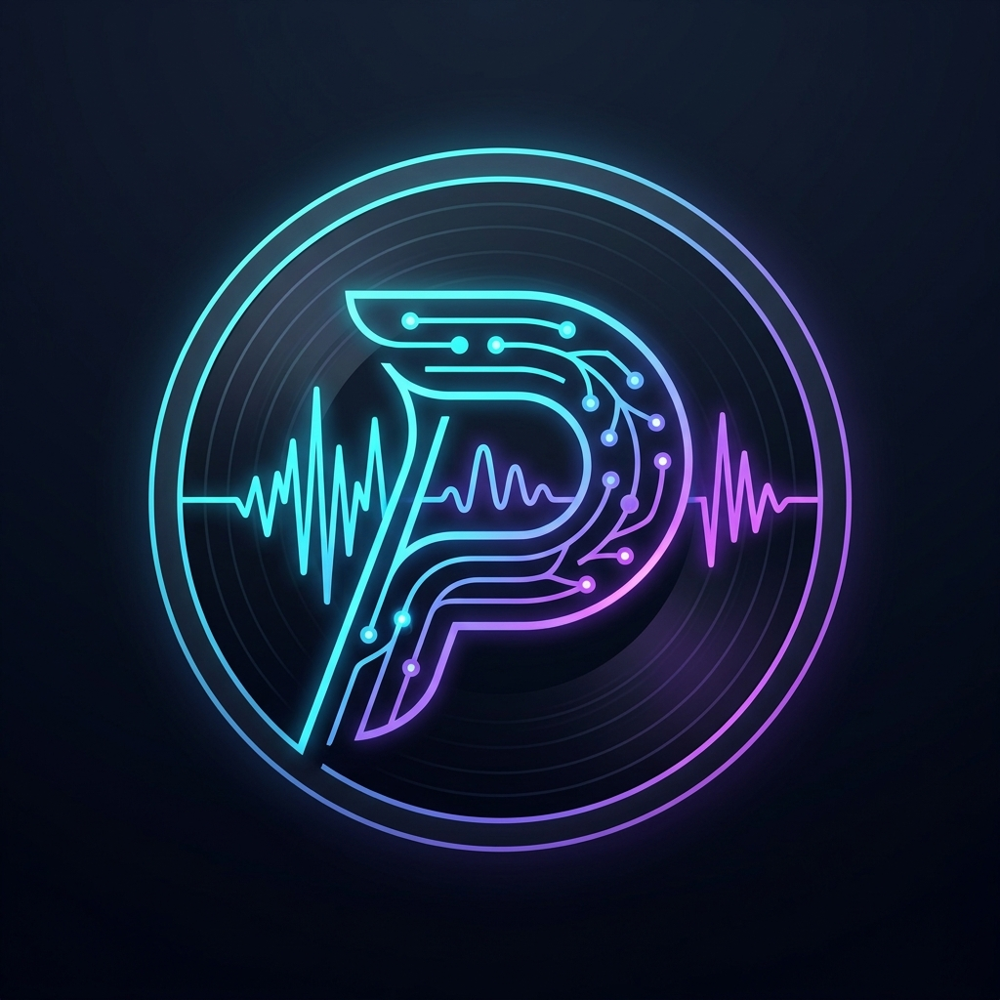
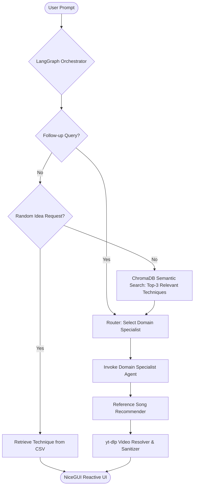

#  ProdAi

> **Intelligent Multi-Agent RAG Assistant for Music Production & Audio Engineering**

ProdAi is a domain-specialized AI assistant designed to eliminate creative and technical bottlenecks in music production. Powered by **LangGraph**, **ChromaDB**, and high-speed **Groq LPU** inference, ProdAi dynamically routes user queries across 5 specialized audio engineering personas, augments responses with verified production techniques from a local vector knowledge base, and enriches answers with contextual reference tracks and timestamped video demonstrations.

---

## 🌟 Key Features

- **Multi-Agent State Graph (LangGraph)**:
  - Intelligently routes queries across 5 specialized agent personas with tailored system prompts and temperature profiles:
    - 🎛️ **Mixing Engineer**: Dynamic range compression, equalization, saturation, stereo imaging (Nigel Godrich style).
    - 🎹 **Sound Designer**: Modular synthesis, sampling, granular textures, psychoacoustic effects (Brian Eno style).
    - 🎼 **Composer**: Harmonic progressions, modal voice leading, structural arrangement, rhythm sections.
    - ✍️ **Lyricist**: Thematic development, metaphorical storytelling, hooks, and meter alignment.
    - 📋 **Project Manager**: Production roadmapping, milestone coordination, and creative direction.

- **Offline-First Domain RAG (ChromaDB + HuggingFace)**:
  - Semantic vector retrieval backed by `BAAI/llm-embedder` sentence transformers running locally on CPU.
  - Persistent ChromaDB vector storage with MD5 dataset hash validation (`ideas_csv.hash`) to avoid redundant re-indexing on startup.

- **Automated Media & Reference Enrichment**:
  - Dynamically identifies real-world reference tracks demonstrating discussed production techniques.
  - Resolves and sanitizes YouTube tutorials and song examples using `yt-dlp` without requiring paid API keys.
  - Interactive playback embedded directly in chat with custom timestamp offsets (`&start=...`) and direct fallback links.

- **Ultra-Low Latency & Zero API Cost**:
  - Powered by Groq LPU inference with dynamic runtime model auto-discovery (`qwen/qwen3.8-27b`).
  - Zero-token keyword-first classification and strict token budget enforcement to maximize throughput under free-tier quotas.

- **Reactive Web Interface (NiceGUI)**:
  - Clean, responsive Python-native UI built on Vue/Quasar.
  - Live execution telemetry, clickable idea inspiration cards, and non-blocking asynchronous chat streaming.

---

## 🏗️ Architecture Overview



---

## 📂 Project Structure

```text
ProdAi/
├── img/                       # Brand assets & UI icons
│   ├── logo1.png              # ProdAi primary emblem
│   ├── logo2.png              # ProdAi circular badge / favicon
│   ├── db_icon.png            # Vector database avatar
│   └── sprite.png             # User chat avatar
├── src/
│   ├── agent_framework.py     # LangGraph workflow, routing, & specialist agents
│   ├── config.py              # Environment configuration & credential validation
│   ├── logger.py              # Structured logging & NiceGUI UI telemetry
│   ├── rag.py                 # ChromaDB vector store & HuggingFace embeddings
│   └── youtube.py             # yt-dlp search engine & video embed sanitizer
├── ui.py                      # NiceGUI reactive web frontend
├── ideas.csv                  # Knowledge base of audio engineering techniques
├── pyproject.toml             # Project dependencies and packaging metadata
└── .env                       # API credentials configuration
```

---

## 🚀 Quickstart

### 1. Prerequisites
- **Python 3.12+**
- **uv** package manager ([Install uv](https://docs.astral.sh/uv/getting-started/installation/))
- A free **Groq API Key** ([console.groq.com](https://console.groq.com/keys))

### 2. Installation

```bash
# Clone the repository
git clone https://github.com/your-username/ProdAi.git
cd ProdAi

# Install dependencies with uv
uv sync
```

### 3. Configure Environment

Create a `.env` file in the project root:
```env
GROQ_API_KEY=gsk_your_groq_api_key_here
```

### 4. Launch Application

```bash
uv run ui.py
```

The application will initialize the vector store and be accessible at:
👉 **`http://localhost:8001`**

---

## 🛠️ Tech Stack

- **Orchestration & Agents**: [LangGraph](https://github.com/langchain-ai/langgraph), [LangChain](https://github.com/langchain-ai/langchain)
- **Inference**: [Groq Cloud LPU](https://groq.com/)
- **Vector Database**: [ChromaDB](https://www.trychroma.com/)
- **Embeddings**: [HuggingFace Transformers](https://huggingface.co/) (`BAAI/llm-embedder`)
- **Frontend**: [NiceGUI](https://nicegui.io/)
- **Media Ingestion**: [yt-dlp](https://github.com/yt-dlp/yt-dlp)
- **Package Management**: [uv](https://astral.sh/uv)
